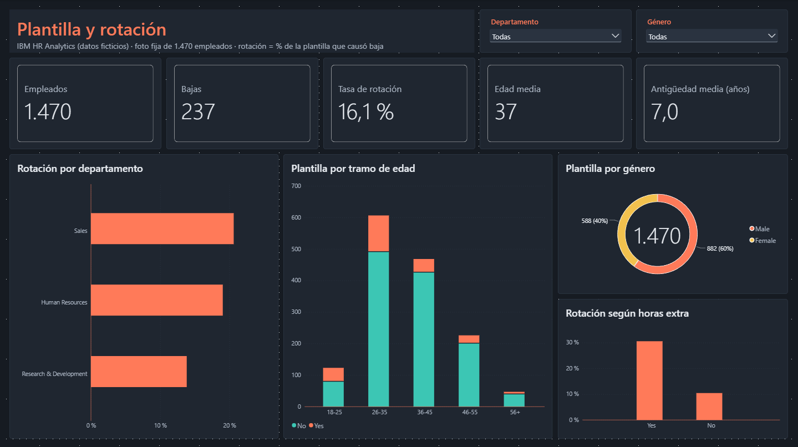
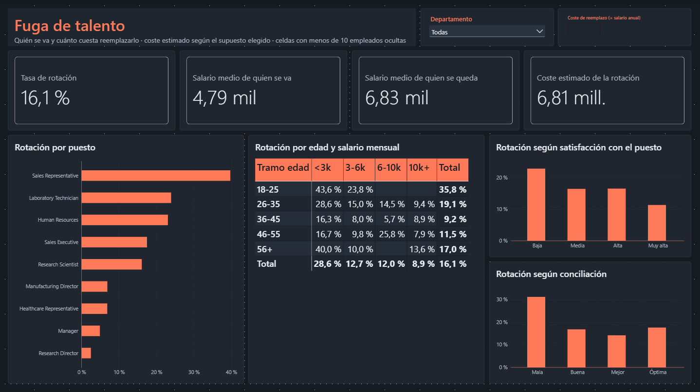
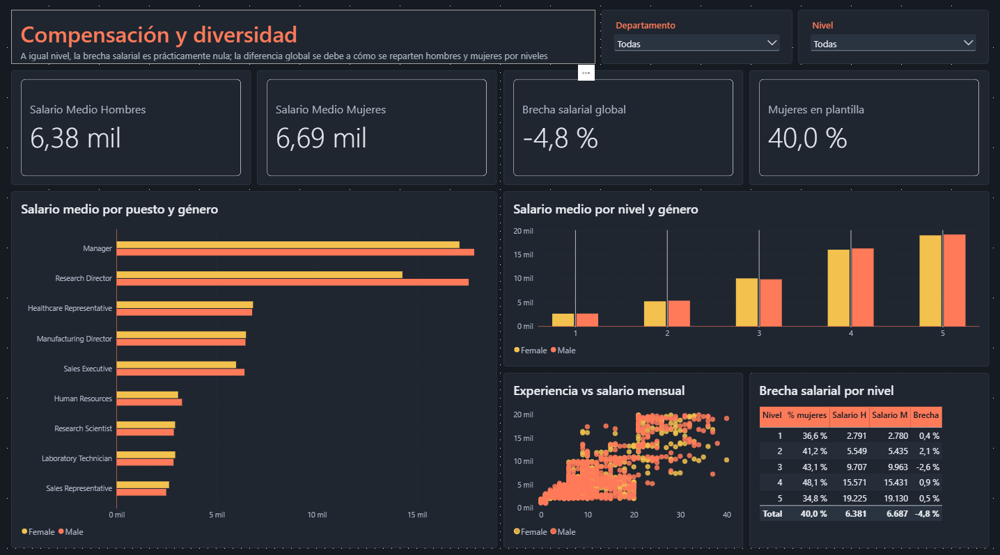

# RR. HH. — Rotación, fuga de talento y brecha salarial

Dashboard de Power BI de analítica de personas: dónde y por qué se va la plantilla, cuánto cuesta reemplazarla y si existe brecha salarial entre hombres y mujeres a igual nivel.

> **Nota**: los datos son ficticios (dataset *IBM HR Analytics Employee Attrition & Performance*, creado por IBM con fines educativos). Es una foto fija de 1.470 empleados: la tasa de rotación es el porcentaje de la plantilla que causó baja, no una tasa anual. El dataset no incluye costes de contratación, por lo que el coste de la rotación se estima con un parámetro ajustable y se presenta como supuesto.

## El dashboard

Informe de tres páginas, filtrable por departamento, género y nivel.

**Plantilla y rotación** — Plantilla, bajas, tasa de rotación (16,1 %), edad y antigüedad medias. Rotación por departamento, distribución por edad separando bajas y permanencias, composición por género y efecto de las horas extra: quienes hacen horas extra se van en torno al triple que quienes no las hacen.


**Fuga de talento** — Rotación por puesto (los Sales Representative rozan el 40 %), mapa de calor por edad y tramo salarial, y rotación según satisfacción con el puesto y conciliación. Quien se va cobra de media un 30 % menos que quien se queda. El coste de la rotación se recalcula con un parámetro de hipótesis (coste de reemplazo como múltiplo del salario anual).


**Compensación y diversidad** — Salario medio por puesto, nivel y género, experiencia frente a salario y brecha por nivel. La brecha global es del −4,8 % (las mujeres cobran algo más de media), pero a igual nivel la diferencia no supera el ±3 %: la brecha global refleja cómo se reparten hombres y mujeres entre niveles, no diferencias de pago a igual puesto.


## Modelo de datos

Tabla única de empleados: con 1.470 filas y una sola entidad, un esquema en estrella no aportaría nada. El trabajo está en la preparación y en las medidas.

Aspectos técnicos destacados:

- **Limpieza en Power Query**: eliminación de columnas constantes (`EmployeeCount`, `Over18`, `StandardHours`) y de tarifas incoherentes con el salario mensual (`DailyRate`, `HourlyRate`, `MonthlyRate`). Las escalas codificadas del 1 al 4 se traducen a etiquetas, y se crean tramos de edad, antigüedad y salario con columna de orden.
- **Parámetro de hipótesis** para el coste de reemplazo, que recalcula el coste estimado de la rotación en función del supuesto elegido.
- **Control de muestras pequeñas**: el mapa de calor oculta las celdas con menos de 10 empleados para no destacar tasas basadas en dos o tres personas.
- **Brecha bruta frente a brecha por nivel**: la comparación entre ambas separa el efecto de composición de una posible diferencia salarial a igual puesto.
- **Tema propio** en JSON (`tema-rrhh.json`).

## Stack

Power BI · DAX · Power Query

## Fuente de datos

*IBM HR Analytics Employee Attrition & Performance* — https://www.kaggle.com/datasets/pavansubhasht/ibm-hr-analytics-attrition-dataset

## Estructura del repositorio

```
.
├── README.md
├── dashboard.pbix
├── tema-rrhh.json
└── images/
    ├── plantilla_rotacion.png
    ├── fuga_talento.png
    └── compensacion_diversidad.png
```
